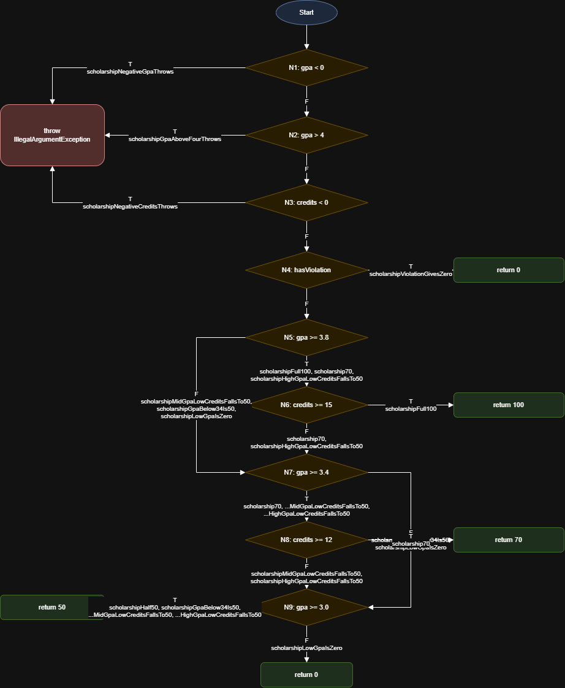

# Лаборатори №9: Код хамралт — JaCoCo-гоор тестээ хөтлөх

F.CSA313 — Программ хангамжийн чанарын баталгаа ба туршилт (2026)

- **Нэр:** Б. Аззаяа
- **Оюутны код:** B242270803

## Орчин

`java -version` болон `mvn -version` гаралт:
- Java: OpenJDK 17.0.20.1 (Ubuntu / WSL2)
- Maven: Apache Maven 3.9.12

## Хэсэг A: Happy path тестүүд ба эхний хэмжилт

5 happy-path тест бичсэн (`letterGradeA`, `letterGradeB`, `gpaTwoGrades`, `scholarshipFull100`, `scholarshipHalf50`). `results/mvn-verify-A.txt`-д `Tests run: 5`.

| Хэмжүүр | Хамрагдсан | Нийт | Хувь |
|---|---|---|---|
| Line | 16 | 25 | 64% |
| Branch | 20 | 41 | ≈ 48.8% |

Тоонууд `results/jacoco-A.csv`-тэй таарна (`LINE_COVERED=16`, `LINE_MISSED=9`, `BRANCH_COVERED=20`, `BRANCH_MISSED=21`).

**Ажиглалт.** Шар ромботой мөрүүд нь нөхцөлийн зөвхөн нэг тал нь шалгагдсан салаанууд: `score >= 80`, `hasViolation`, `gpa >= 3.0`, мөн `&&` нөхцөлүүдийн кредит дутуу тал. Улаан мөрүүд нь огт хүрээгүй замууд: гурван `throw new IllegalArgumentException`, C/D/F үсгэн дүн, `switch`-ийн `case "C"`, `case "D"` болон `return 0`. Happy-path тест зөвхөн хэвийн оролт өгдөг тул алдааны зам болон бага дүнгийн салаанд хүрдэггүй.

## Хэсэг B: CFG ба branch 100%

> **Зургийн тайлбар:** Энэхүү зурагт `scholarship()` функцийн хяналтын урсгалыг ромбо хэлбэрийн шийдвэрийн зангилаануудаар дүрсэлсэн бөгөөд ирмэгүүд дээр нөхцөлийн үнэн (T) / худал (F) салаа болон тэдгээрийг шалгах харгалзах тестүүдийн нэрс бичигдсэн. Мөн эхний `||` болон дараагийн `&&` логик нөхцөлүүд нь кодын салбарлалт бүрээр салангид зангилаанууд (`N1`-ээс `N9`) болж задарсныг харуулсан.

Branch хамралтыг 100% хүргэхэд нийт **22** тест шаардагдсан (`results/mvn-verify-B.txt`-д `Tests run: 22`). Хэсэг A-д 5 тест байсан тул 17 тест нэмсэн. `results/jacoco-B.csv`-д `BRANCH_MISSED = 0`, `LINE_MISSED = 0` (Branch 41/41, Line 25/25).

Нэмсэн тестүүдийн гол санаа:
- `scholarship()`-ийн эхний `if (gpa < 0 || gpa > 4 || credits < 0)`-ийн нөхцөл бүрт тусдаа `assertThrows` тест бичсэн (`scholarshipNegativeGpaThrows`, `scholarshipGpaAboveFourThrows`, `scholarshipNegativeCreditsThrows`), учир нь JaCoCo `||` нөхцөл бүрийг тусдаа салаа гэж тоолдог.
- `&&` нөхцөлүүдийн кредит дутуу талыг `scholarshipHighGpaLowCreditsFallsTo50`, `scholarshipMidGpaLowCreditsFallsTo50` тестүүд хамарсан.
- `gpa()`-ийн `switch`-ийн `default` (F дүн) салааг `gpaAllGradeLetters` (A, B, C, D, F бүгд орсон массив) хамарсан.
- `letterGrade()`-ийн C, D, F болон хоёр хилийн алдааг тусдаа тестээр хамарсан.

## Хэсэг C: Давталтын заагийн тестүүд

`gpa()` дахь `for (double s : scores)` давталтыг 0, 1, 2+ удаа ажиллуулдаг тестүүд:

| Давталт | Тест | Оролт | Хүлээгдэх үр дүн |
|---|---|---|---|
| 0 удаа | `gpaEmptyThrows`, `gpaNullThrows` | `{}`, `null` | `IllegalArgumentException` |
| 1 удаа | `gpaSingleGrade` | `{95}` | 4.0 |
| 2+ удаа | `gpaManyGrades` | `{95, 85, 75, 65}` | 2.5 |

`results/mvn-verify-C.txt`-d `Tests run: 24`. Хамралт 100% хэвээр (`results/jacoco-C.csv`).

**Яагаад хэрэгтэй вэ:** Эдгээр тестүүд нь кодыг шугаман байдлаар гүйцэтгэхэд үр дүн хэвийн гарах эсэхээс гадна давталтын хил хязгаарын нөхцөлд (хоосон массив, ганц элемент эсвэл олон элемент өгөх үед) програмын логик алдаагүй ажиллаж буйг баталгаажуулдаг. Өөрөөр хэлбэл, кодын мөр болон салбарын хамралт 100% болсон ч давталтын заагийн тохиолдлуудыг тухайлан шалгах нь өгөгдлийн бүрэн бүтэн байдал, найдвартай ажиллагааг хангах чухал ач холбогдолтой юм.

## Хэсэг D: Хамралт 100% — гэхдээ алдаа амьд

`ScholarshipCalculator.java`-ийн `letterGrade()`-д `score > 60` гэж бичигдсэн, `score >= 60` байх ёстой.
**Засвар:** `Fix letterGrade: > 60 -> >= 60, spec says 60 is D` commit.

**Гол дүгнэлт:** Кодын мөр болон branch хамралт 100% хүрсэн байсан ч энэхүү логикийн алдаа шууд анзаарагдаагүй нь хамралтын хэмжүүрүүд програмын зөв ажиллах нөхцөлийг бус, зөвхөн тестүүд кодын хэсгүүдээр хэрхэн гүйж өнгөрснийг л хэмждэг болохыг харуулж байна. Өөрөөр хэлбэл, `> 60` болон `>= 60` гэдэг нь JaCoCo хэрэгслийн хувьд ижилхэн хоёр салаа үүсгэж байсан тул тестүүд тухайн салбаруудыг бүрэн хүрч шалгасан ч гэсэн яг 60 оноо авсан үед гарах ёстой үр дүнгийн бодит шаардлагыг (бизнесийн логикийг) шалгаж чадаагүй байжээ. Тиймээс код хамралт 100% байх нь тухайн програм ямар нэгэн алдаагүй, бүрэн зөв ажиллаж байна гэсэн баталгаа болж чадахгүй бөгөөд зөвхөн код үлдэгдэлгүй шалгагдсаныг л илтгэдэг ажээ.

Эцсийн үр дүн: `results/jacoco-final.csv`-д `BRANCH_MISSED = 0`, `LINE_MISSED = 0`, `Tests run: 34`, бүх тест ногоон.

## AI-ийн ашиглалт

Тестийн логик болон харгалзах шалгалтын хил хязгаарын аргуудыг зохиох явцад санаа авах зорилгоор AI-аас зөвлөгөө авсан. Мөн кодын Control Flow Graph (CFG) бүтцийг ойлгох, Git болон Maven тохиргооны алдааг засварлахад тусламж авсан.
